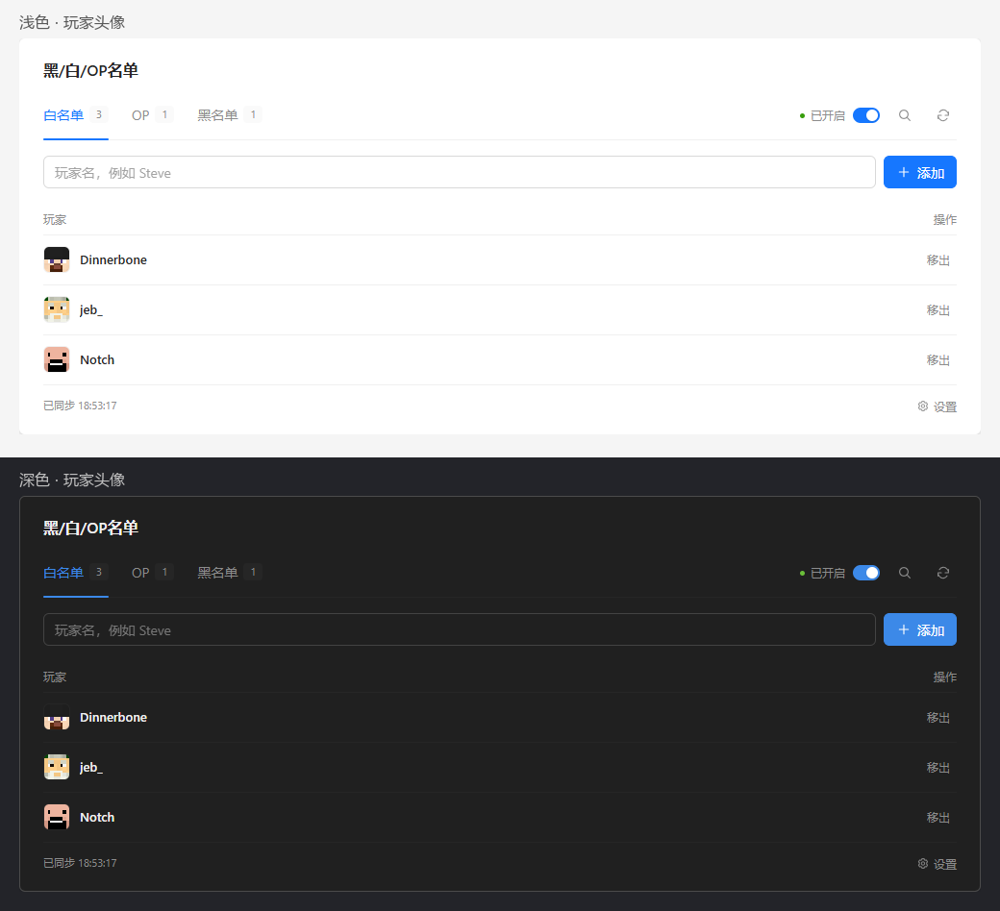
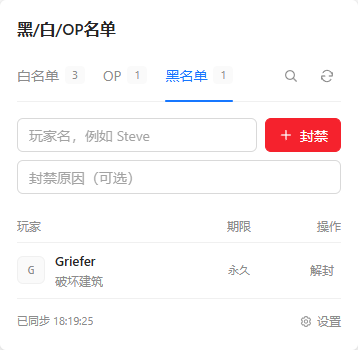

# MCSM Player Access

[](LICENSE)
[](https://github.com/MCSManager/MCSManager)

MCSManager 玩家权限管理扩展卡片，可视化管理 Minecraft 实例的 **OP、白名单与黑名单**，支持深浅主题和移动端适配。

单个 HTML 文件，无需安装依赖或填写 API Key，使用面板当前登录用户的权限。

## 预览



截图使用模拟实例数据。

<details>
<summary>查看窄屏效果</summary>



</details>

## 功能

| 名单 | 支持操作 |
| --- | --- |
| 白名单 | 添加、移出、切换入服限制 |
| OP | 授予、撤销、显示权限等级 |
| 黑名单 | 封禁、解封、填写可选原因、显示原因与期限 |

- 继承面板的主题配色，切换深浅主题时同步更新。
- 适配手机和桌面窄网格卡片。
- 按玩家名或 UUID 搜索；黑名单还支持按原因搜索。
- UUID 默认隐藏，可悬停玩家名查看，或在设置中展开。
- 按 UUID 显示玩家的 Minecraft 头像，包含皮肤外层；加载失败时保留字母占位。
- 自动识别当前实例，按实例保存服务端相对目录。
- 操作后回读确认结果，读取失败时显示错误，避免把失败当作空名单。

## 安装

1. [下载卡片 HTML](https://raw.githubusercontent.com/qch7/MCSM-Player-Access/main/mcsm-player-access-card.html)，另存为 `mcsm-player-access-card.html`。
2. 进入 MCSManager 中某个 Minecraft 实例的控制台，开启**设计模式**。
3. 添加**扩展页面卡片**，上传下载的 HTML 文件。卡片标题可填写“玩家权限”。
4. 保存布局，退出设计模式，刷新页面。

更新时，在原扩展卡片中重新上传新版 HTML，保存并刷新即可。直接在浏览器打开 HTML 只显示未连接状态；实际管理功能需在 MCSManager 中使用。

### 服务端目录

默认从实例工作目录读取以下文件：

```text
whitelist.json
ops.json
banned-players.json
server.properties
```

如果这些文件位于子目录，在卡片的“设置”中填写相对目录，例如 `server`；根目录填写 `/`。设置保存在当前浏览器，按实例区分。

## 使用说明

- 实例运行时可编辑，停止或启停过程中仅可查看。实例启动完成后点击刷新，重新读取状态。
- 新增 OP 的等级由服务端 `op-permission-level` 决定，卡片不编辑单个 OP 的等级。
- 黑名单使用原版 `ban` / `pardon` 命令，新增封禁为永久。已有带期限的条目会显示日期或“已到期”，卡片不设置封禁时长。
- 封禁会踢出在线玩家；移出白名单不会踢出在线玩家，OP 可能绕过白名单。
- 身份和 UUID 由当前服务端解析。命令未确认成功时，请检查实例控制台中的认证、名字或权限提示。
- 卡片通过服务端命令修改名单，不直接覆写 JSON，也不会启动、停止或重启实例。其他地方修改名单后，需要手动刷新。

### 玩家头像

头像优先由 [MCHeads](https://mc-heads.net/) 提供，加载失败时自动尝试 [Minotar](https://minotar.net/)，两个来源均失败时显示字母。浏览器通过 HTTPS 按名单中的 UUID 加载图片，不携带面板登录凭据或页面来源，使用浏览器缓存并按需加载。列表重绘优先复用当前可用的来源，点击刷新可重新尝试。

头像对应 Mojang 账号的公开皮肤，支持正版账号上传的自定义皮肤。离线 UUID、第三方认证或仅在本地替换的皮肤不一定能获得对应头像，服务可能返回默认皮肤；皮肤更换后也可能需要等待缓存更新。

## 兼容性与验证

当前版本为 **v1.3.1**，接口按 **MCSManager v10.21.2** 制作，目标为 Minecraft Java 服务端（原版 / Fabric）。其他面板版本、服务端或修改原版权限命令的插件尚未验证。

使用支持 CSS 容器查询的现代浏览器。已通过模拟实例检查名单操作、命令回读、主题切换、停止及读取失败状态、320–1280px 布局和桌面窄网格卡片布局，并验证公开账号头像加载及失败回退；这些检查不代表所有真实服务器环境均已验证。

## 贡献与反馈

欢迎通过 [Issues](https://github.com/qch7/MCSM-Player-Access/issues) 反馈问题，或提交 Pull Request。开发和验证方式见 [CONTRIBUTING.md](CONTRIBUTING.md)，版本变化见 [CHANGELOG.md](CHANGELOG.md)。

## 许可证

本项目采用 [MIT License](LICENSE)。本项目是独立扩展卡片，与 [MCSManager](https://github.com/MCSManager/MCSManager) 主项目分别维护；MCSManager 的名称和上游代码遵循其自身的权利与许可证。
